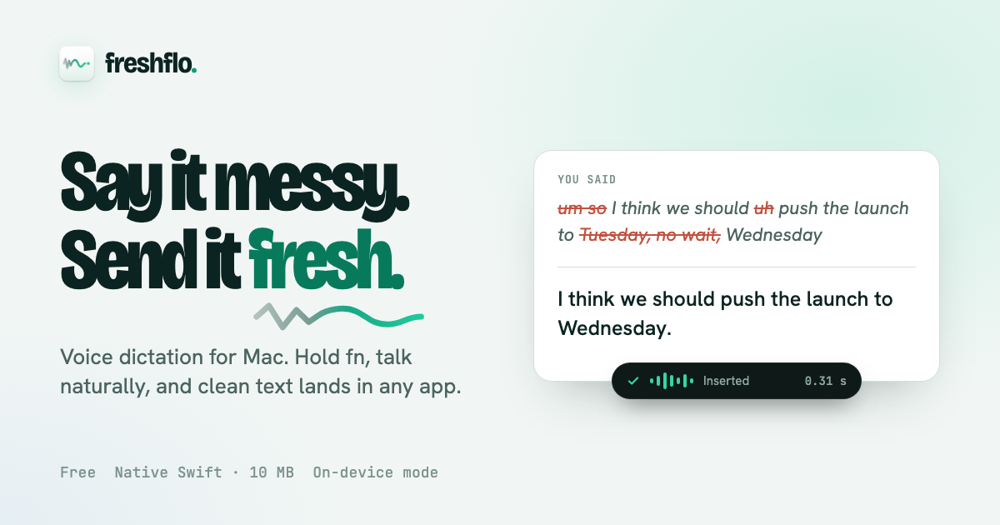
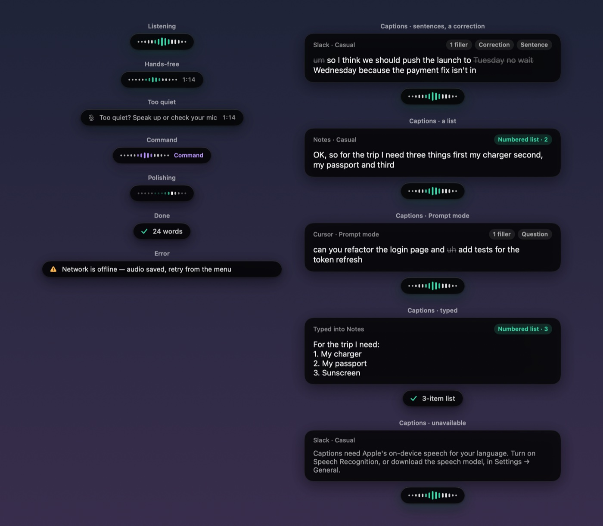
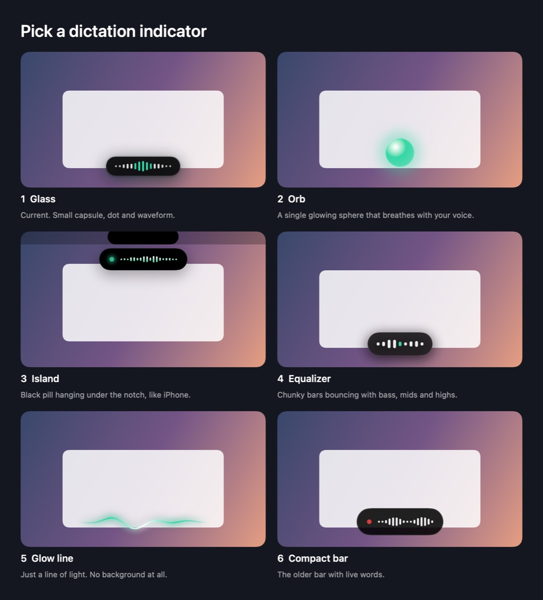
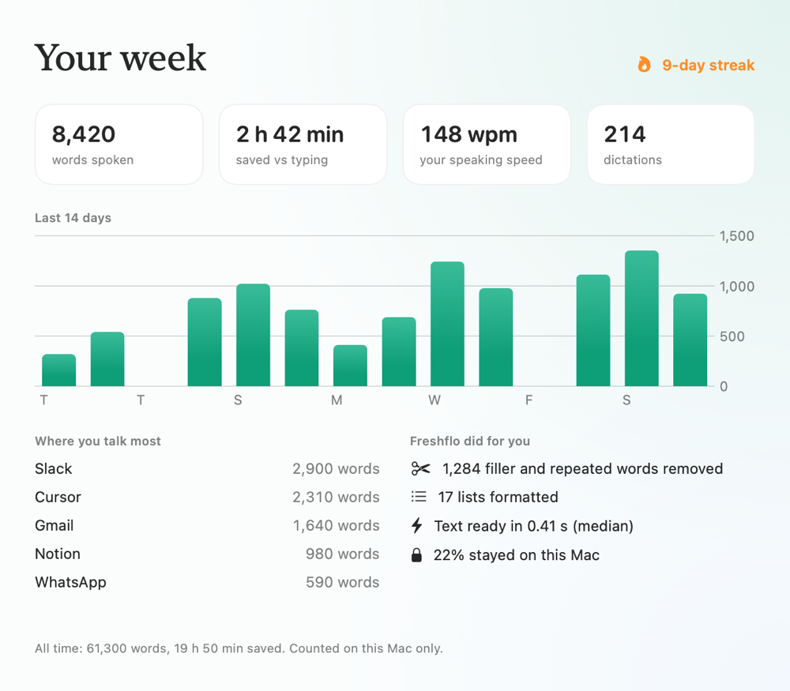
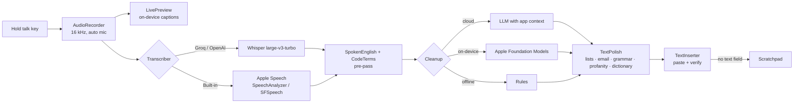

<p align="center">
  
</p>

<h1 align="center">Freshflo</h1>

<p align="center">
  <b>Voice dictation for Mac that writes the way you meant it.</b><br>
  Hold a key, talk naturally, let go. Clean, punctuated, grammatically correct text appears in any app.
</p>

<p align="center">
  <a href="https://freshflo.vercel.app"><b>Website</b></a> ·
  <a href="https://freshflo.vercel.app/welcome"><b>Download</b></a> ·
  <a href="https://freshflo.vercel.app/changelog">Changelog</a> ·
  <a href="https://freshflo.vercel.app/help">Help</a> ·
  <a href="https://freshflo.vercel.app/compare">How it compares</a>
</p>

<p align="center">
  
  
  
  
  
  
  <a href="LICENSE"></a>
</p>

---

## Built on NVIDIA Nemotron + Nebius Token Factory

Freshflo's entire intelligence layer runs on **[NVIDIA Nemotron](https://www.nvidia.com/en-us/ai-data-science/foundation-models/nemotron/) served by [Nebius Token Factory](https://tokenfactory.nebius.com)** (OpenAI-compatible, `api.tokenfactory.nebius.com/v1`). Pick the **Nebius Token Factory (NVIDIA Nemotron)** engine in *Settings → General → Transcription*.

- **Nemotron for all reasoning** — meeting notes, Ask, Command, cleanup, and the new **Chat with your meetings**. A resolver queries Token Factory's live `/models` catalog and always prefers a Nemotron model, so the app stays on an NVIDIA model even if ids change.
- **Token Factory for speed and scale** — streamed server-sent events from `/chat/completions` power token-by-token chat; Super/Nano handle fast everyday calls and the larger Nemotron handles heavier reasoning (cross-meeting commitment tracking).
- **Private by design** — Token Factory serves LLMs, not audio, so speech is transcribed **on-device** (WhisperKit) and only the few most relevant text excerpts ever reach the cloud.
- **Shows its work** — every note, chat answer and commitment list carries a *"NVIDIA Nemotron on Nebius Token Factory"* badge with the exact model id.

**Setup & demo:** [`hackathon/SETUP.md`](hackathon/SETUP.md) · **Write-up:** [`hackathon/DEVPOST.md`](hackathon/DEVPOST.md) · **Demo script:** [`hackathon/DEMO_SCRIPT.md`](hackathon/DEMO_SCRIPT.md). No meetings yet? Click **Try it with sample meetings**, or run `swift run Freshflo --seed-demo`.

> Built for the **Nebius × NVIDIA Global AI Hackathon** (Personal AI track). Freshflo is a pre-existing macOS app; the hackathon work re-platformed its AI stack onto Nebius Token Factory + NVIDIA Nemotron and added **Chat with your meetings** and **Open commitments**.

---

## What it does

| You say | Freshflo types |
|---|---|
| “um so I think we should push the launch to Tuesday, no wait, Wednesday” | I think we should push the launch to Wednesday. |
| “first my charger, second my passport, third sunscreen” | 1. My charger<br>2. My passport<br>3. Sunscreen |
| “hi marcus can you send the deck before friday thanks priya” *(in Mail)* | Hi Marcus,<br><br>Can you send the deck before Friday?<br><br>Thanks,<br>Priya |
| “rename it to camel case fetch user profile in package dot json” | Rename it to fetchUserProfile in package.json. |
| “he is having fever since two days, me and him will come later” | He has had a fever for two days. He and I will come later. |
| “send the invoice for two lakh fifty thousand rupees” *(Indian formats)* | Send the invoice for ₹2,50,000. |

It works in every app with a text field: Slack, Gmail, Notion, Cursor, the terminal, WhatsApp, Google Docs. Free and unlimited, no account.

## Highlights

<table>
<tr>
<td width="50%" valign="top">

**Writing**
- Removes fillers, stutters and repeats; applies self-corrections.
- Fixes grammar, including Indian-English patterns, while keeping your words.
- **Smart lists**, **email mode**, **code words**, and **Prompt mode** for Cursor, Claude, ChatGPT and Claude Code.
- Per-app style, personal dictionary that learns your corrections, snippets.
- About 100 languages; speak one, write another (Hindi or Hinglish in, English out).

</td>
<td width="50%" valign="top">

**Everything around it**
- **Live captions** of what you're saying and what Freshflo detects.
- **Meeting notes** with who said what, a clean transcript, follow-up email and Slack summary; offered automatically when a call starts.
- **Ask your meetings**, and use them inside **Claude and Cursor** (MCP).
- **Scratchpad**, **Your Week** stats, sync through iCloud Drive or a team folder.
- **On-device Whisper** (no key, offline), names from Contacts and Calendar, Hindi interface.
- Automatic mic choice (AirPods-aware), whisper mode, weekly recap.

</td>
</tr>
</table>

<p align="center">
  <br>
  <sub>The Glass bar (left) and live captions with what Freshflo detects (right), rendered from the app's code.</sub>
</p>

<table>
<tr>
<td width="55%"></td>
<td width="45%"></td>
</tr>
<tr>
<td align="center"><sub>Six indicator styles to choose from</sub></td>
<td align="center"><sub>Your Week: words, time saved, streak</sub></td>
</tr>
</table>

## How it works



Every engine's output goes through the same deterministic final pass (`TextPolish`), so lists, grammar fixes, swear-word handling and dictionary spellings come out the same whether the cloud model, Apple's model or the offline rules did the cleanup. Model output is checked (`Cleanup.sanitize`) so a model that answers or summarises instead of cleaning up is rejected.

Meetings record two tracks (your mic, and the call via ScreenCaptureKit with music apps excluded). The call track is split into voices locally with MFCC fingerprints and clustering (`Diarization`), then named from introductions.

## Project layout

```
Sources/
  Freshflo/            app entry point (CLI and MCP modes first, then the menu-bar app)
  FreshfloKit/         everything else, ~12k lines of Swift
    DictationController   hotkey → record → transcribe → clean up → insert
    AudioRecorder         capture, silence trimming, whisper-mode gain, mic ranking
    Transcriber, LocalSpeech, LivePreview    cloud / Apple speech engines, live captions
    Cleanup, TextPolish, SpokenEnglish, ListFormat, Formatting   the writing pipeline
    Pill, StatsView, Scratchpad, MeetingsView, SettingsView, Onboarding   UI (SwiftUI)
    Meetings, MeetingRecorder, Diarization, CallDetection, Knowledge   meeting notes, MCP
    Updater, Insights, Sync, Permissions, FocusContext   updates, opt-in telemetry, plumbing
  FreshfloChecks/      339 behaviour checks (no XCTest needed)
Benchmarks/           real-speech clips, cases, grammar eval set, reports
scripts/              build-app.sh, make-dmg.sh, benchmark audio
```

## Build and run

Needs macOS 14+ and the Swift 6 toolchain (Xcode Command Line Tools are enough).

```bash
swift build                          # debug build
swift run FreshfloChecks             # 339 checks
./scripts/build-app.sh               # universal, signed build/Freshflo.app (runs the checks first)
./scripts/build-app.sh --install     # …and install to /Applications
./scripts/make-dmg.sh                # build/Freshflo-<version>.dmg
```

Grant Microphone and Accessibility when asked. For the fastest engine, add a free [Groq](https://console.groq.com/keys) key in Settings; it's stored in the Keychain.

### Developer tools (CLI)

The same binary has test hooks, so behaviour can be checked without clicking through the UI:

| Command | What it does |
|---|---|
| `--transcribe clip.wav --app <bundle id>` | Full pipeline on an audio file, as if dictated into that app |
| `--grammar-eval Benchmarks/grammar.json --pace 4000` | Grammar test set (76 cases) through the real cleanup |
| `--benchmark Benchmarks/audio` | Accuracy and latency benchmark on real speech |
| `--meeting --you a.wav --them b.wav [--actions]` | Meeting pipeline end to end: speakers, notes, clean transcript, follow-ups |
| `--diarize call.wav --starts 0,4.2,…` | Speaker clustering on a recording |
| `--ask-meetings "question" --demo` | Ask your meetings against sample notes |
| `--render-pill` / `--render-styles` / `--render-stats out.png` | Render UI states to PNG for design review |
| `--mic-info` | Every mic, how it's classified, the automatic choice, call detection |
| `--mcp` | Run as an MCP server over stdio (for Claude, Cursor, Claude Code) |
| `--check-update` | Check the update feed, verify checksum and signature |

## Use it from Claude and Cursor

```bash
claude mcp add -s user freshflo -- "/Applications/Freshflo.app/Contents/MacOS/Freshflo" --mcp
```

Or Settings → General → *Use Freshflo in Claude and Cursor* → Connect. Tools: `search_meetings`, `list_meetings`, `get_meeting`, and `search_dictations` when allowed.

## Releasing

1. Bump `CFBundleShortVersionString` / `CFBundleVersion` in `Resources/Info.plist` and add notes to `WhatsNew` in `Updater.swift`.
2. `./scripts/build-app.sh && ./scripts/make-dmg.sh`
3. In [freshflo-website](https://github.com/divyanshus2404/freshflo-website): `./release.sh ../ExcuseMe/build/Freshflo-X.Y.Z.dmg "note" …`, add a changelog entry, build and deploy.
4. Installed apps pick it up from `updates.json`; each update is checked against its SHA-256 and code signature before it's installed.

## Privacy

No account and no tracking by default. Dictations, history, dictionary and meeting notes stay on the Mac. Audio only leaves the Mac when you choose a cloud engine, and History marks every dictation as on-device or cloud. Anonymous usage counts and crash reports are opt-in. Details: [privacy policy](https://freshflo.vercel.app/privacy).
